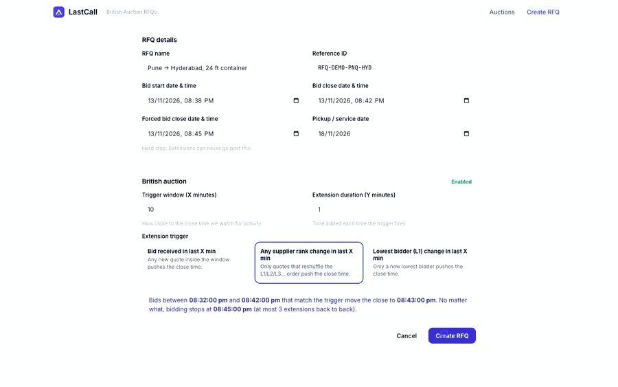
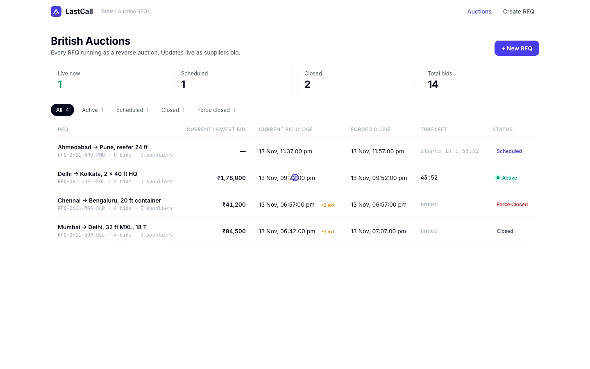
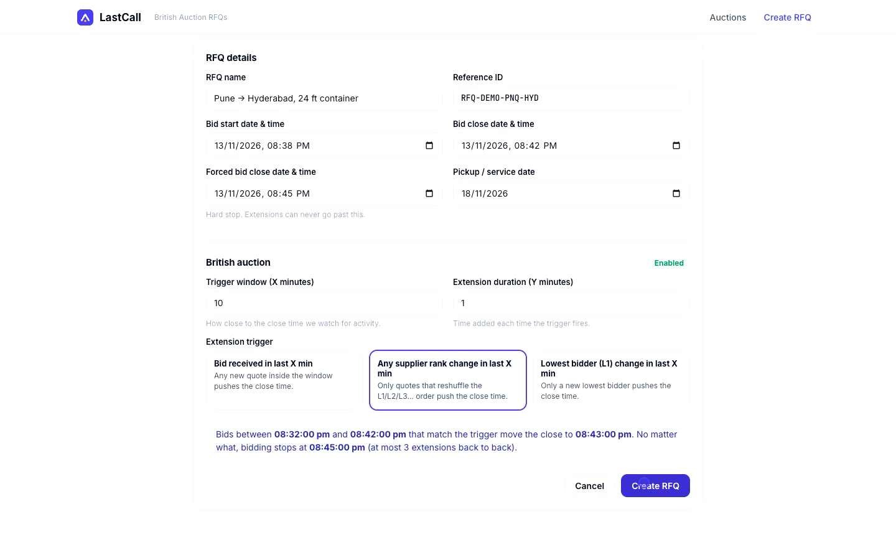
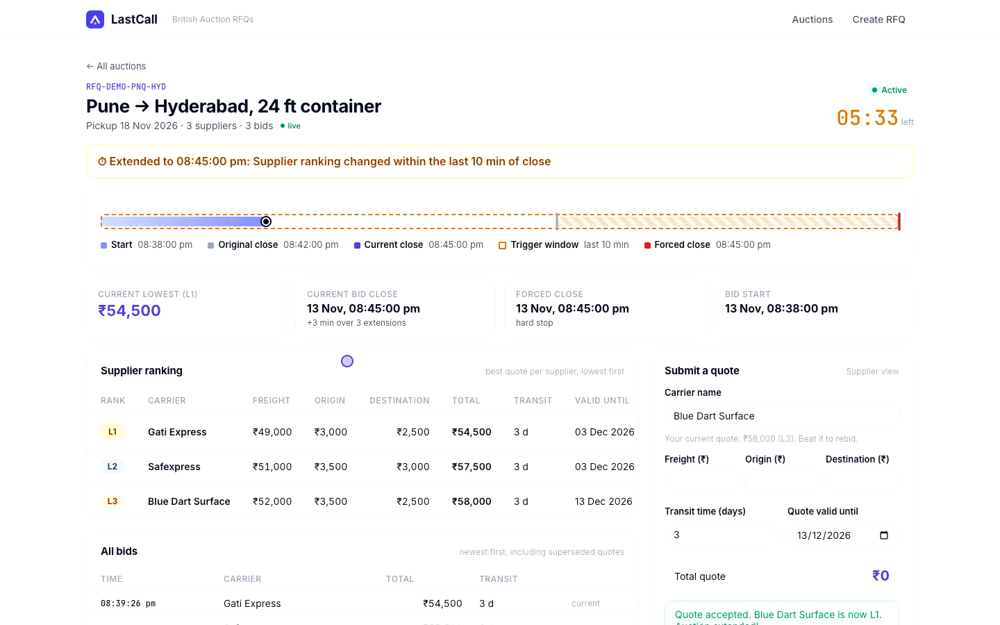
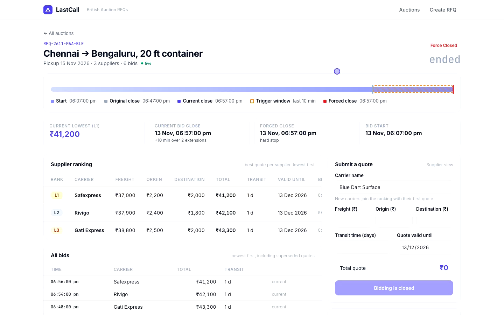
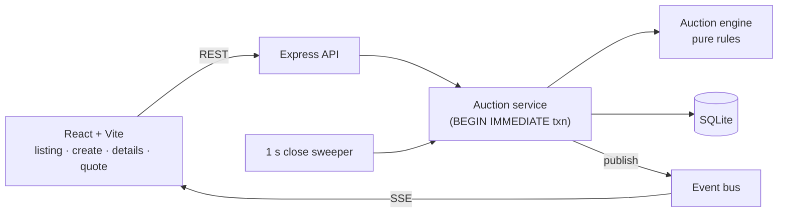

<div align="center">


# LastCall

**An RFQ platform where carriers compete in a British auction, with automatic time extensions, a hard forced close, and live L1 / L2 / L3 ranking.**

[](https://github.com/amartya1523/lastcall-rfq-auction/actions/workflows/ci.yml)


</div>

---

## 🎬 Demo

<p align="center">
  
</p>

<p align="center">
  <a href="docs/media/lastcall-demo.mp4"><b>▶ Watch the full 2:24 walkthrough with voiceover</b></a>
</p>

What the walkthrough covers:

| Time | What you see |
|---|---|
| 0:00 | Auction listing: lowest bid, current close, forced close, status filters |
| 0:20 | Creating an RFQ. Forced close earlier than bid close is blocked inline |
| 0:34 | British auction config (X, Y, trigger type) with a plain-English preview |
| 0:51 | Live auction timeline, and a carrier submits a quote |
| 1:08 | Bid inside the trigger window extends the close, and the activity log says why |
| 1:18 | Other carriers bid over SSE, the ranking reorders live, and the close reaches the forced close |
| 1:33 | A cheaper bid that keeps the same rank does **not** extend (rank-change trigger) |
| 1:42 | A new L1 at the forced close: extension **blocked** and logged |
| 1:55 | A finished auction that was **force closed**, with its full audit trail |

---

## ✅ Assignment coverage

| Requirement (from the brief) | Where it lives |
|---|---|
| RFQ creation with British auction enabled (name / ref, start, close, forced close, pickup date) | [`CreateRfq.jsx`](frontend/src/pages/CreateRfq.jsx), `POST /api/rfqs` |
| Quote fields: carrier, freight / origin / destination charges, transit time, validity | [`QuoteForm.jsx`](frontend/src/components/QuoteForm.jsx), `POST /api/rfqs/:id/bids` |
| 6.1 Trigger window **X** · 6.2 Extension **Y** | [`engine.js → evaluateExtension`](backend/src/engine.js) |
| 6.3 Triggers: **a)** bid received **b)** any rank change **c)** L1 change | [`engine.js`](backend/src/engine.js), tested with the brief's own examples in [`engine.test.js`](backend/test/engine.test.js) |
| 7. Forced close > bid close · extensions never exceed forced close | Validator + engine `min()` cap + SQL `CHECK` constraint (enforced 3×) |
| 8. Listing: name / ID, lowest bid, current close, forced close, status (Active / Closed / Force Closed) | [`AuctionList.jsx`](frontend/src/pages/AuctionList.jsx) |
| 8. Details: bids sorted by price, L1/L2/L3, quote details, X & Y config, activity log with extension reasons | [`AuctionDetail.jsx`](frontend/src/pages/AuctionDetail.jsx), [`ActivityLog.jsx`](frontend/src/components/ActivityLog.jsx) |
| 9. HLD with architecture diagram | [`docs/HLD.md`](docs/HLD.md) |
| 9. Schema design | [`docs/SCHEMA.md`](docs/SCHEMA.md) |
| 9. Backend / frontend code | [`backend/`](backend) · [`frontend/`](frontend) |

---

## 📸 Screens

| Auction listing | Create RFQ |
|---|---|
|  |  |
| **Live auction (after 3 extensions)** | **Force-closed auction + audit trail** |
|  |  |

---

## 🧠 How the auction works

```
                trigger window (X)             extension (Y)
              ┌──────────────────┐            ┌────┐
──────────────┼──────────────────┼────────────┼────┼────────────┤
         bid start          current close   new close        forced close
                                  ▲                             (hard stop)
                     qualifying bid lands here → close += Y, capped at forced close
```

- **Window:** `current_close − X ≤ bid_time < current_close`. It moves with every extension.
- **Triggers** (they nest: L1 change ⊂ rank change ⊂ any bid):
  - `BID_RECEIVED`: any accepted bid in the window.
  - `ANY_RANK_CHANGE`: the order of suppliers changed (someone overtook someone, or a new supplier entered). Lowering your price while keeping your position doesn't count.
  - `L1_CHANGE`: a different supplier is now the lowest bidder.
- **Extension:** `new_close = min(current_close + Y, forced_close)`.
- **Forced close:** once `current_close == forced_close`, later triggers are logged as `EXTENSION_SKIPPED` instead of extending.
- **Status** is derived from time, never stored: *Scheduled → Active → Closed* (ended before the forced close) or *Force Closed* (ran into it).
- **Bidding rules:** ranking is by total (`freight + origin + destination`). A supplier can only re-bid **lower** than their own current quote, and ties go to the earlier bid.

Full reasoning, sequence diagram and trade-offs are in **[docs/HLD.md](docs/HLD.md)**.

---

## 🏗️ Architecture



- **Backend:** Node.js 22+, Express, built-in `node:sqlite`. Express is the only runtime dependency.
- **Frontend:** React 18, React Router, Vite, plain CSS.
- **Realtime:** Server-Sent Events. Every open listing and details page updates when anyone bids.
- **Correctness:** each bid is validated, ranked and checked for extension inside **one transaction**, using the **server clock**.

Schema (5 tables: `rfqs`, `auction_configs`, `suppliers`, `bids`, `activity_log`) with ER diagram and constraints: **[docs/SCHEMA.md](docs/SCHEMA.md)**.

---

## 🚀 Run it locally

Requires **Node.js 22.13+** (for the built-in SQLite module).

```bash
git clone https://github.com/amartya1523/lastcall-rfq-auction.git
cd lastcall-rfq-auction
npm run install:all     # backend + frontend deps
npm run seed            # demo data: closed, force-closed, live and scheduled auctions
npm run build           # build the React app
npm start               # API + UI on http://localhost:4100
```

For development with hot reload, run these in two terminals:

```bash
npm run dev:api         # http://localhost:4100
npm run dev:web         # http://localhost:5175 (proxies /api)
```

Run the tests:

```bash
npm test                # 21 tests: engine rules + full API flow with a fake clock
```

---

## 🔌 API

| Method | Path | Description |
|---|---|---|
| `GET` | `/api/rfqs` | All auctions with lowest bid, close times, status, bid & supplier counts |
| `POST` | `/api/rfqs` | Create an RFQ + auction config |
| `GET` | `/api/rfqs/:id` | Full detail: ranking, all bids, config, activity log, `serverTime` |
| `POST` | `/api/rfqs/:id/bids` | Submit a quote. Returns `{ rank, extension, rfq }` |
| `GET` | `/api/events` | SSE stream: `rfq.created`, `bid.submitted`, `auction.closed` |

<details>
<summary>Example: create an RFQ</summary>

```bash
curl -X POST localhost:4100/api/rfqs -H 'content-type: application/json' -d '{
  "name": "Mumbai → Delhi, 32 ft MXL",
  "referenceId": "RFQ-2611-BOM-DEL",
  "bidStartAt": "2026-11-15T12:00:00Z",
  "bidCloseAt": "2026-11-15T12:30:00Z",
  "forcedCloseAt": "2026-11-15T12:45:00Z",
  "pickupDate": "2026-11-18",
  "triggerWindowMin": 10,
  "extensionMin": 5,
  "triggerType": "L1_CHANGE"
}'
```
</details>

<details>
<summary>Example: submit a quote</summary>

```bash
curl -X POST localhost:4100/api/rfqs/1/bids -H 'content-type: application/json' -d '{
  "carrierName": "Blue Dart Surface",
  "freightCharges": 52000,
  "originCharges": 3500,
  "destinationCharges": 2500,
  "transitTimeDays": 3,
  "quoteValidityDate": "2026-12-01"
}'
# → 201 { "rank": 1, "extension": { "from": "...", "to": "...", "reason": "New lowest bidder (L1) within the last 10 min of close" }, "rfq": {...} }
```
Errors: `400` with per-field messages, `404` for an unknown RFQ, and `409` when bidding hasn't started or is closed.
</details>

---

## 📁 Project structure

```
lastcall-rfq-auction/
├── backend/
│   ├── src/
│   │   ├── engine.js      # pure auction rules: ranking, triggers, extension, status
│   │   ├── service.js     # transactions, persistence, activity log, close sweep
│   │   ├── validate.js    # request validation + typed errors
│   │   ├── db.js          # schema + SQLite setup
│   │   ├── events.js      # SSE event bus
│   │   ├── app.js         # Express routes
│   │   └── server.js      # entry point
│   ├── scripts/seed.js    # demo data replayed with a moving clock
│   └── test/              # node:test unit + API tests
├── frontend/src/
│   ├── pages/             # AuctionList, CreateRfq, AuctionDetail
│   ├── components/        # Timeline, QuoteForm, ActivityLog, badges…
│   └── live.js            # server-clock sync + SSE hook
└── docs/                  # HLD, schema, media
```

---

## 🤔 Assumptions & decisions

- **Supplier identity = carrier name** (case-insensitive). There's no auth in scope, so the quote form acts as the supplier view and the rest of the page as the buyer view.
- **Extensions add to the current close**, not to the bid time, matching the brief's example (6:00 → 6:05).
- **A blocked extension is still logged** so the buyer can see that the forced close cut the auction short.
- **Every quote is kept** (append-only), so revisions are auditable. Ranking uses each supplier's best quote.
- **Money is stored in paise and time in epoch ms** to avoid float and timezone bugs. Formatting is done in the UI (INR, IST via the browser locale).

## 🔭 With more time

- Buyer / supplier auth, plus a sealed mode where suppliers only see their own rank and the L1 price
- Minimum bid decrement (for example ₹500 or 0.5%) to stop ₹1 undercuts
- Postgres with a row lock per RFQ, and Redis pub/sub for multi-instance SSE
- An award flow after close, with buyer notifications on extension and close
- Metrics for the success criteria in the brief: bids per RFQ, and savings vs. the first L1 / non-extended auctions

---

<p align="center">Built by <b>Amartya Vikram Singh</b> for the GoComet Full Stack Intern assignment.</p>
