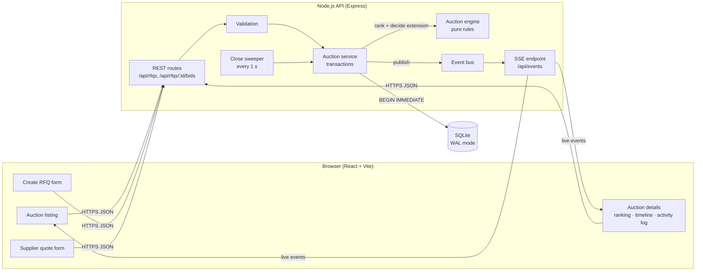
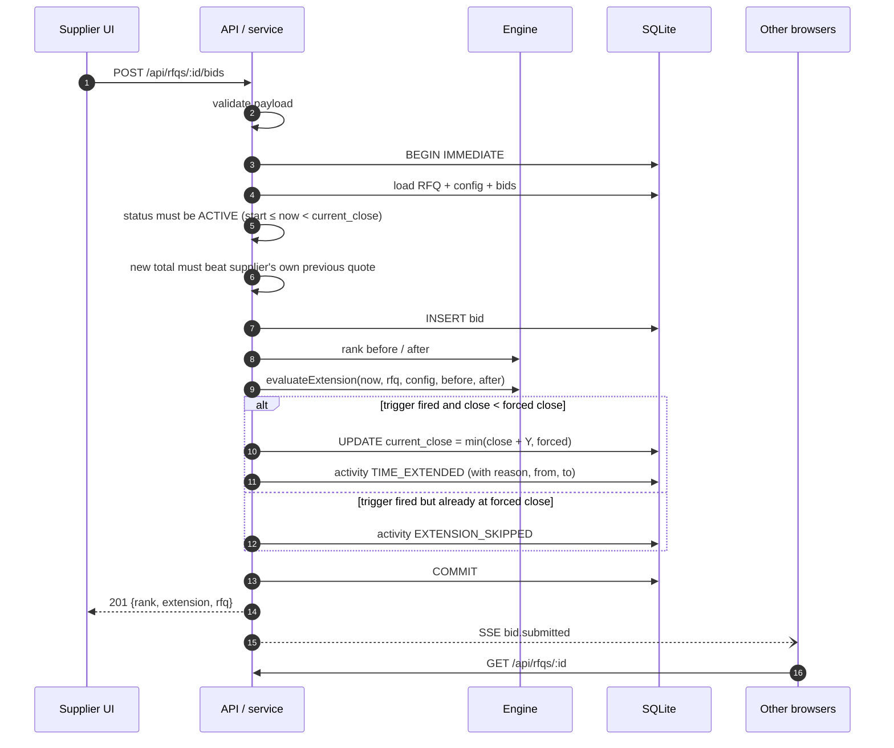

# High-Level Design

## 1. What we are building

A buyer publishes an RFQ (for example "Mumbai → Delhi, 32 ft MXL"). Carriers compete by
quoting lower and lower prices in a **British (reverse) auction**. If a qualifying bid lands
close to the end, the close time is pushed out so nobody can snipe the auction in its last
seconds. A **forced close time** puts a hard ceiling on all of that.

## 2. Architecture

| Component | Responsibility |
|---|---|
| **React app** | Listing, create form, details page and quote form. Countdown and status are computed against the *server* clock (offset synced from every response), so a skewed laptop clock never shows the wrong state. |
| **REST API** | Thin Express routes. Errors are mapped to `400` (field errors), `404`, `409` (auction not open). |
| **Validation** | Field-level rules, including *forced close > bid close*, positive charges, transit 1-365 days. |
| **Auction service** | Owns every write. A bid is accepted, ranked, and the extension decision is made **inside one `BEGIN IMMEDIATE` transaction**, so two simultaneous bids can't both read the same old close time. |
| **Auction engine** | Pure functions: `rankBids`, `rankingChanged`, `l1Changed`, `evaluateExtension`, `auctionStatus`. No I/O, so every rule is unit-tested directly from the examples in the brief. |
| **Close sweeper** | Once a second, finds auctions whose close time has passed and writes a single `AUCTION_CLOSED` / `AUCTION_FORCE_CLOSED` entry. Status itself is derived from time, so correctness does not depend on the sweeper. |
| **Event bus + SSE** | After every change the service publishes an event; open browsers refetch the affected RFQ. SSE was picked over WebSockets because traffic is one-way (server → client) and it works through proxies with zero extra dependencies. |

## 3. Bid lifecycle

## 4. Auction rules

**Trigger window.** A bid is in the window when
`current_close − X min ≤ bid time < current_close`. The window is measured from the
*current* close, so after an extension the window moves with it.

**Triggers.** They nest. Every L1 change is a rank change, and every rank change comes from a bid.

| Trigger | Fires when (inside the window) |
|---|---|
| `BID_RECEIVED` | any accepted bid |
| `ANY_RANK_CHANGE` | the ordered list of suppliers changes: someone overtakes someone, or a new supplier enters the ranking. A supplier who lowers their price but keeps their position does **not** count. |
| `L1_CHANGE` | the supplier in first place is different from before |

**Extension.** `new_close = min(current_close + Y, forced_close)`. Extensions add to the
current close, not to the bid time, which matches the brief (6:00 → 6:05).

**Forced close.** It's enforced in three places: the validator (`forced > close` on create),
the engine (`min(...)` cap), and the database (`CHECK (current_close_at <= forced_close_at)`).
If the close is already at the forced close, the trigger is still written to the log as
`EXTENSION_SKIPPED`, so the buyer can see the auction *wanted* to extend.

**Status** is derived, never stored:

| Status | Condition |
|---|---|
| Scheduled | `now < bid_start` |
| Active | `bid_start ≤ now < current_close` |
| Closed | `now ≥ current_close` and `current_close < forced_close` |
| Force Closed | `now ≥ current_close` and `current_close = forced_close` |

**Ranking.** Each supplier's best quote counts (`freight + origin + destination`). Ties go to
the earlier bid. A supplier may only re-bid **lower** than their own current quote, which is
what makes it a British auction.

## 5. Design decisions and trade-offs

- **SQLite (built into Node 22+).** Zero setup for reviewers and real transactions and
  `CHECK` constraints. The SQL is portable: moving to Postgres means swapping `BEGIN IMMEDIATE`
  for `SELECT … FOR UPDATE` on the RFQ row.
- **Money in paise, time in epoch ms.** Integer columns avoid float rounding and timezone bugs.
  Formatting happens only in the UI.
- **Server is the only clock.** Bids are timestamped by the server inside the transaction, and
  the client clock is never trusted.
- **Activity log is append-only.** It doubles as an audit trail: every extension stores
  `from`, `to`, `reason` and the bid that triggered it.

## 6. Scaling path (beyond the assignment)

| Concern | Next step |
|---|---|
| Many API instances | Postgres plus row lock per RFQ. Replace in-process event bus with Redis pub/sub. |
| Thousands of watchers | SSE fan-out through a dedicated gateway, or push the ranking diff instead of a refetch. |
| Close timing precision | Replace the 1 s sweeper with a delayed job queue keyed on `current_close_at`. |
| Auth / roles | Buyer vs supplier accounts, and suppliers see only their own rank + L1 price (sealed mode). |
