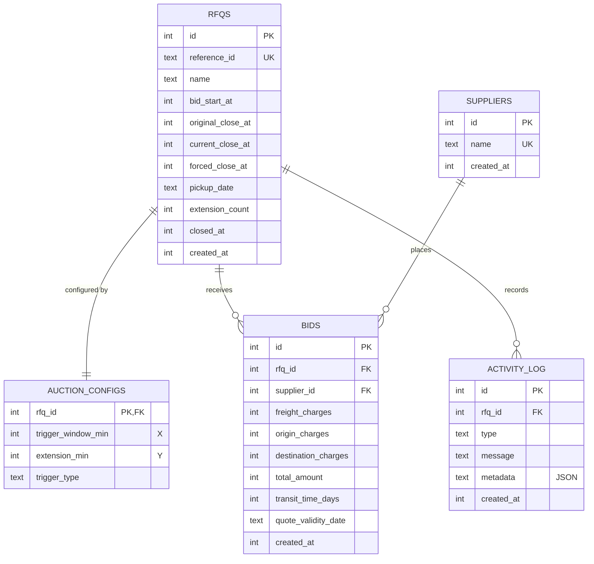

# Database Schema

SQLite, created on boot from [`backend/src/db.js`](../backend/src/db.js).
Timestamps are epoch **milliseconds** (`INTEGER`), and money is **paise** (`INTEGER`).



## Tables

### `rfqs`
| Column | Type | Notes |
|---|---|---|
| `id` | INTEGER PK | |
| `reference_id` | TEXT UNIQUE | e.g. `RFQ-2611-BOM-DEL` |
| `name` | TEXT | |
| `bid_start_at` | INTEGER | |
| `original_close_at` | INTEGER | close time as created, kept for reporting |
| `current_close_at` | INTEGER | moves forward on each extension |
| `forced_close_at` | INTEGER | hard stop |
| `pickup_date` | TEXT `YYYY-MM-DD` | pickup / service date |
| `extension_count` | INTEGER | |
| `closed_at` | INTEGER NULL | set once by the close sweeper (idempotency guard for the close log entry) |
| `created_at` | INTEGER | |

Constraints:
```sql
CHECK (original_close_at > bid_start_at)
CHECK (forced_close_at   > original_close_at)   -- validation rule 1
CHECK (current_close_at >= original_close_at)
CHECK (current_close_at <= forced_close_at)     -- validation rule 2, enforced by the DB too
```

### `auction_configs`
One row per RFQ (split out so other auction types can have their own config tables later).

| Column | Type | Notes |
|---|---|---|
| `rfq_id` | INTEGER PK → `rfqs.id` | |
| `trigger_window_min` | INTEGER > 0 | **X** |
| `extension_min` | INTEGER > 0 | **Y** |
| `trigger_type` | TEXT | `BID_RECEIVED` \| `ANY_RANK_CHANGE` \| `L1_CHANGE` |

### `suppliers`
| Column | Type | Notes |
|---|---|---|
| `id` | INTEGER PK | |
| `name` | TEXT UNIQUE `COLLATE NOCASE` | carrier name, so "Blue Dart" and "blue dart" are the same supplier |
| `created_at` | INTEGER | |

### `bids`
Every submitted quote is kept (append-only), so revisions are auditable. A supplier's
ranking uses their lowest total.

| Column | Type | Notes |
|---|---|---|
| `id` | INTEGER PK | |
| `rfq_id` | INTEGER → `rfqs.id` | |
| `supplier_id` | INTEGER → `suppliers.id` | |
| `freight_charges` / `origin_charges` / `destination_charges` | INTEGER ≥ 0 | paise |
| `total_amount` | INTEGER > 0 | sum of the three, what we rank on |
| `transit_time_days` | INTEGER > 0 | |
| `quote_validity_date` | TEXT `YYYY-MM-DD` | |
| `created_at` | INTEGER | server time of acceptance |

Indexes: `(rfq_id, supplier_id, created_at)` for "my latest quote", `(rfq_id, total_amount)` for the lowest bid.

### `activity_log`
| Column | Type | Notes |
|---|---|---|
| `id` | INTEGER PK | |
| `rfq_id` | INTEGER → `rfqs.id` | |
| `type` | TEXT | `RFQ_CREATED`, `BID_SUBMITTED`, `TIME_EXTENDED`, `EXTENSION_SKIPPED`, `AUCTION_CLOSED`, `AUCTION_FORCE_CLOSED` |
| `message` | TEXT | human readable, shown in the UI |
| `metadata` | TEXT (JSON) | e.g. `{"reason": "...", "from": 1763..., "to": 1763..., "capped": false, "triggeredBy": 42}` |
| `created_at` | INTEGER | |

Index: `(rfq_id, created_at)`.

## Example queries

Current ranking for an RFQ (best quote per supplier):
```sql
SELECT s.name, MIN(b.total_amount) AS best
FROM bids b JOIN suppliers s ON s.id = b.supplier_id
WHERE b.rfq_id = ?
GROUP BY b.supplier_id
ORDER BY best ASC, MIN(b.created_at) ASC;
```

Why did this auction run late?
```sql
SELECT datetime(created_at / 1000, 'unixepoch') AS at, message
FROM activity_log
WHERE rfq_id = ? AND type IN ('TIME_EXTENDED', 'EXTENSION_SKIPPED')
ORDER BY created_at;
```
